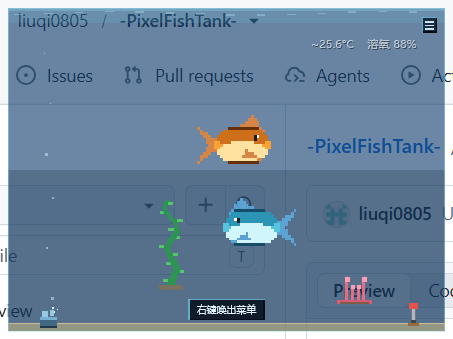

# PixelFishTank · 桌面像素鱼缸悬浮组件

一个纯 Win32 + Direct2D 1.1 的桌面宠物级小玩具：无边框、分层透明、始终置顶、不抢焦点，
水里养最多两条像素鱼，有水温 / 溶氧 / 饱食度 / 肥胖 / 心情 / 死亡一整条生态链。
全部美术资源外部化在 `assets/` 里（PNG 序列 + JSON 描述），程序只认 PNG + JSON。



> 上图就是实际运行的窗口（554×415），两条鱼（金鱼 + 孔雀鱼）、两株水草、
> 左下增氧器正在冒泡、右下加温棒；背景里隐约的图标是**桌面本身透出来的**，不是贴图。

---

## 0. 最近一次更新（第三轮）

| 反馈 | 原因 | 改法 |
| --- | --- | --- |
| 点菜单「调整尺寸·小/中/大」卡死 | 那三项走 `SetSizeForDivider → SetWindowPos`，而 `SetWindowPos` 会**同步回调 WM_SIZE**，正好撞上点击时持有的世界锁 + 渲染线程的锁，交叉等待 | **三项全删**（菜单从 11 项变 8 项），`SetSizeForDivider/ResizeToWidth/MaxWindowWidth` 一并移除 |
| 想直接拖窗口改大小 | — | 曾加过右下角/右边缘/底边缘拖拽（4:3、下限 2/3），**后被用户否掉**：放大时仍会卡 → 缩放功能整体删除，改为**固定尺寸** |
| 锁了穿透后右键跑到桌面上 | `WS_EX_TRANSPARENT` 是一刀切，☰ 也一起穿透了 | 每 40ms 查光标：在 ☰（或已开菜单）上就临时摘掉 `WS_EX_TRANSPARENT`，其他地方保持穿透 |

回归：`tools/fix3_probe.py` 14 项全 PASS。

## 0. 本次更新（第二轮）

用户提的三个问题 + 两个改进，全部已改并做了自动化回归：

| 反馈 | 原因 | 改法 |
| --- | --- | --- |
| 鼠标一离开鱼，【喂食/挑逗】就消失，点不到 | 按钮显隐完全跟着 `hoverFish`，鼠标挪向按钮途中离开鱼身就变 -1 | `buttonOwner` + `buttonHold`：鼠标在鱼身或按钮行都刷新，**保持 0.4 秒**；命中按钮时用 owner 定位鱼 |
| 连点多了整个程序卡住、鱼不游 | ① `WorldReadLock` 用 `t_worldLockDepth` 反推是否释放，共享锁会永久泄漏；② 点击在 UI 线程独占锁里直接改世界 | ① 共享/独占深度分开计数、谁取谁放；② 世界动作 `EnqueueAction` 入队，逻辑线程 `DrainActions` 统一执行；③ 加看门狗日志 |
| 没有常驻菜单入口 | 只有右键 | 右上角常驻 ☰，菜单关掉入口还在（菜单项也加了「关闭到托盘」） |
| 水温 / 含氧常驻显示 | — | `Ui::DrawHud`：右上角 `25.6°C  溶氧 88%`，小字、白色半透明、带黑影 |
| 后台运行 / 最小化到托盘 | — | `Shell_NotifyIconW` 托盘图标（我画的像素小鱼）+ 左键切显隐 + 右键菜单；关窗默认**收进托盘**，隐藏时渲染降到 ~5fps、生态逻辑照跑 |

回归证据：`tools/fix_probe.py` 10 项全 PASS（截图 `_preview/fix_*.png`）；
`tools/fix4_probe.py` 11 项全 PASS（固定尺寸 / 拖动角落无效 / 菜单 8 项 / 锁定穿透下 ☰ 仍可点 / 关窗进托盘）；
原有 `interaction_probe.py`、`smoke_test.ps1` 也通过。

> 所有美术素材都可以**同名替换**：动画帧按 `sprite.json` 里的 `frameWidth/frameHeight` 来，
> 托盘图标 `assets/ui/tray/icon.png` 任意尺寸都行（程序最近邻缩到 32×32）。

---

## 1. 需求对照表

| 硬性要求 | 实现位置 | 说明 |
| --- | --- | --- |
| 无边框分层透明窗口 `WS_EX_LAYERED\|TOPMOST` | `src/App.cpp` `Init()` | `WS_POPUP`，用 `UpdateLayeredWindow` 逐帧推送 ARGB 位图 |
| 透明区域鼠标穿透、可直接点桌面图标 | `Renderer::End()` + 分层 alpha 命中 | 逐像素 alpha 由系统做命中测试：alpha=0 的点直接落到桌面 |
| 置顶但不抢输入焦点 | `WM_MOUSEACTIVATE` 返回 `MA_NOACTIVATE` + `WS_EX_NOACTIVATE` | 点击鱼缸不会把前台窗口抢走 |
| Per-Monitor 高 DPI | `src/main.cpp` + `src/app.manifest` | `DPI_AWARENESS_CONTEXT_PER_MONITOR_AWARE_V2`；`WM_DPICHANGED` 跟随系统建议矩形 |
| 水体空白处拖动窗口 | `App::OnLeftButtonDown` / `OnDragMove` | 命中水体且不在鱼/按钮/菜单上时进入拖动 |
| 窗口尺寸固定（不提供缩放） | `App::Init` | 只算一次「当前显示器面积 / 24」的 4:3 尺寸；存档只恢复位置，不恢复尺寸；拖拽缩放整体移除 |
| 缩放用最近邻、像素不糊 | `Renderer::GetBitmap` + `DrawBitmapNearest` | `SetAntialiasMode(ALIASED)`、`D2D1_BITMAP_INTERPOLATION_MODE_NEAREST_NEIGHBOR` |
| 退出存盘 / 启动读盘 | `src/Persist.cpp` | `state.json` 写在 exe 同级目录（不可写时退到 `%LOCALAPPDATA%\PixelFishTank`） |
| 资源全部外部化 | `src/ResourceManager.cpp` | 启动扫 `assets/fish`、`assets/plant`、`assets/ui` 下的子目录 |
| 每鱼 = PNG 序列 + sprite.json | `src/Sprite.cpp` | 6 种动画、帧宽高、帧时长、鼠标碰撞盒都在 JSON 里 |
| 最多同时 2 条鱼 | `src/Common.h` `kMaxFish` | 槽位 `world_.fish[2]`，死鱼清理后空位可再添加 |
| 天气驱动的温度基准（WinHTTP 异步 + 离线兜底） | `src/Weather.cpp` | 独立工作线程同步调 WinHTTP，失败自动用正弦日周期离线曲线 |
| 增氧器 / 加温棒 放置移除 | `Ui::DrawPanel` + `sim::ApplyAction` | 面板按钮切换，设备图标画在水体底部 |
| 溶氧衰减、鱼数/肥胖越高耗氧越快 | `src/Simulation.cpp` | 见 §5 参数表 |
| 溶氧略低游得慢、长期过低死亡 | 同上 | 阈值 30，累计 180 秒死亡 |
| 饱食度衰减 / 饿死 / 频繁喂食变胖 | 同上 | 饿 90 秒死亡；单次喂食肥胖 +0.07 |
| 心情：单鱼衰减、双鱼不衰减、挑逗回复 | 同上 | 单鱼 -0.05/s，挑逗 +26 |
| 死亡播死亡动画、不再响应交互、延时清除 | 同上 | 30 秒后清除，空位可新增鱼 |
| 交互优先级 鱼 > 面板 > 穿透 | `Ui::HitTest` | 菜单 > ☰ 入口 > 缩放角标/边缘 > 鱼按钮 > 鱼碰撞盒 > 面板按钮 > 水体 > 穿透 |
| 悬停鱼出【喂食 / 挑逗】 | `Ui::UpdateLayout` / `App::HandleAction` | 按钮画在鱼上方，避开水面就翻到下方 |
| 悬停水体出【增氧器 / 加温棒】面板 | 同上 | 面板固定在水体左上角 |
| 右键菜单 8 项 | `Ui::BuildMenu` | 添加水草、添加鱼、清空鱼缸、重置环境、锁定鼠标穿透、开机自启、关闭到托盘、退出 |
| Direct2D 管线、60fps、最近邻 | `src/Renderer.cpp` + `App::RenderLoop` | 渲染顺序：水体 → 水草 → 设备 → 鱼 → UI |
| 逻辑与渲染解耦 | `App::LogicLoop`（10Hz） / `App::RenderLoop`（60fps） | 两个线程 + 可重入 SRW 锁 |
| 用 cJSON，不引大引擎 | `src/third_party/cJSON.{h,c}` | cJSON v1.7.x 单文件 |
| 普通用户权限 | — | 不需要管理员，注册表只写 `HKCU` |
| 预留全局热键 | `App::Init` `RegisterHotKey` | 默认 `Ctrl+Alt+F` 隐藏/显示，热键可在 `state.json` 改 |
| 预留开机自启 | `Persist::ApplyAutostart` | 右键菜单里可开关，写 `HKCU\...\Run` |
| 不读 .blend / glTF | — | 只加载 PNG + JSON |
| 不引入 WebView / Qt / WinForms / WPF | — | 纯原生 Win32 + D2D |
| （增补）鱼按钮移开不消失 | `Common.h` `kFishButtonHold` + `Ui::UpdateLayout` | 鼠标在鱼身或按钮行都刷新，按钮保持 0.4s |
| （增补）连点不卡死 | `App::EnqueueAction` / `DrainActions` + 修好的可重入读写锁 | UI 线程只入队，世界动作由逻辑线程执行 |
| （增补）常驻菜单入口 | `Ui::DrawMenuButton` + `App::OnLeftButtonDown` | 右上角 ☰，菜单关掉入口还在 |
| （增补）常驻水温 / 溶氧 HUD | `Ui::DrawHud` | 右上角小字，白色半透明 + 黑影 |
| （增补）后台运行 + 托盘 | `App::CreateTray` / `ShowTrayMenu` / `HideTankWindow` | 关闭默认收进托盘，隐藏时渲染降到 ~5fps |
| （增补）逻辑线程看门狗 | `App::CheckWatchdog` / `WriteFreezeLog` | 4.5s 不动就把现场写进 `%TEMP%\pft_freezelog.txt` |

---

## 2. 构建

### 2.1 目标环境（按需求）

- Visual Studio 2022（v143 工具集）
- Windows SDK **10.0.22621**
- x64 / Release（Debug 也能编）

直接双击 `PixelFishTank.sln`，选 `Release | x64` 生成即可；或在终端：

```powershell
msbuild PixelFishTank.sln /m /p:Configuration=Release /p:Platform=x64
```

### 2.2 用 `build.ps1`（推荐，会自动兜底）

```powershell
# 默认 Release|x64
.\build.ps1

# 自己指定工具集/SDK
.\build.ps1 -Configuration Debug -Toolset v143 -SdkVersion 10.0.22621.0
```

脚本会自己找 `vswhere` → MSBuild、扫所有 VS 安装目录里可用的
`PlatformToolset`（v145 / v143 / v142）和 SDK 版本，然后只覆盖成“本机真实存在”的值。
**本仓库验证编译用的就是这套兜底**：本机没装 VS2022 和 22621 SDK，
实际是用 VS 2026 的 v145 工具集 + 10.0.26100 SDK 编过的，
工程文件本身仍按需求写死 `v143` / `10.0.22621.0`（你在装了 VS2022 的机器上不用改任何东西）。

产物：`build\x64\Release\PixelFishTank.exe`，`assets\` 会在生成后自动复制到 exe 旁边。

---

## 3. 运行

```
build\x64\Release\
├─ PixelFishTank.exe
├─ assets\            资源（构建时复制过来；也可手动拷）
└─ state.json         第一次正常退出后生成
```

想换位置就整个目录拷走；`assets` 必须和 exe 同级。

---

## 4. 交互速查

| 操作 | 结果 |
| --- | --- |
| 鼠标移到鱼身上 | 弹出【喂食】【挑逗】（移开鱼身后按钮还会留 0.4 秒，够你挪过去点） |
| 点【喂食】 | 播进食动画、饱食度 +28；吃太勤会变胖 |
| 点【挑逗】 | 播挑逗动画、心情 +26 |
| 鼠标移到水体空白处 | 弹出【增氧器】【加温棒】面板 |
| 水体空白处按住左键拖 | 整个鱼缸跟着走 |
| 拖动 → 只能整体移动窗口（尺寸固定，没有缩放手柄） |
| 点右上角 ☰ | 打开/收起常驻菜单（**不用右键也能操作**，菜单项同下） |
| 右键任意位置 / 点右上角 ☰ | 菜单：添加水草、添加鱼、清空鱼缸、重置环境、锁定鼠标穿透、开机自启、关闭到托盘、退出 |
| 右上角常驻 HUD | 实时显示水温与溶氧（`24.3°C 溶氧 85%`，离线时前面带 `~`） |
| 关闭窗口（Alt+F4 / 点关闭） | 默认**收进系统托盘**继续后台养鱼；菜单里「关闭到托盘：关」可改回直接退出 |
| 托盘图标 左键 | 显示 / 隐藏鱼缸 |
| 托盘图标 右键 | 隐藏·显示、开机自启开关、关闭到托盘开关、退出程序 |
| `Ctrl + Alt + F` | 隐藏 / 显示鱼缸（热键可改，见 §6） |

---

## 5. 目录结构

```
PixelFishTank\
├─ PixelFishTank.sln
├─ PixelFishTank.vcxproj / .filters
├─ build.ps1                     一键编译（自动探测工具集与 SDK）
├─ README.md                      ← 本文件
├─ src\
│  ├─ main.cpp                   wWinMain、DPI、单实例、COM
│  ├─ App.h/.cpp                 窗口、消息、60fps 渲染线程、10Hz 逻辑线程
│  ├─ Renderer.h/.cpp            D2D 1.1 + WIC + DWrite，最近邻取样
│  ├─ Ui.h/.cpp                  布局、命中测试、全部 UI 绘制
│  ├─ Simulation.h/.cpp          生态数值与鱼的状态机
│  ├─ Model.h                    World / Fish / Plant / Equipment / Settings
│  ├─ Sprite.h/.cpp              sprite.json 解析、帧序列
│  ├─ ResourceManager.h/.cpp     assets 扫描
│  ├─ Weather.h/.cpp             WinHTTP 线程 + 离线曲线
│  ├─ Persist.h/.cpp             state.json + 开机自启注册表
│  ├─ JsonExt.h                  cJSON 的小封装
│  ├─ Common.h / Util.h/.cpp     基础类型与文件工具
│  ├─ app.manifest               PerMonitorV2 / longPathAware
│  └─ third_party\cJSON.{h,c}
├─ assets\                       ← 见 docs/assets.md（ui	ray\icon.png 是托盘图标，可同名替换）
├─ docs\
│  ├─ architecture.md            线程模型 / 渲染管线 / 命中优先级 / 生态参数
│  └─ assets.md                  资源目录规范、sprite.json 与 state.json 样例（带注释）
├─ tools\
│  ├─ gen_assets.py              用 Pillow 生成占位像素美术（可重复跑）
│  ├─ interaction_probe.py       真实鼠标驱动的交互回归（悬停出按钮 / 喂食 / 面板 / 存盘）
│  ├─ window_probe.py            拖动 / 缩放 / 热键回归
│  ├─ fix4_probe.py              固定尺寸 / 菜单 / 锁定穿透 / 托盘的回归验证
│  ├─ fix_probe.py               本轮修复回归：按钮保持 0.4s / 连点不卡死 / ☰ 菜单 / 托盘
│  ├─ shot.py                    写一份双鱼存档并截图（README 那张图就是它出的）
│  └─ smoke_test.ps1             最小冒烟：启动 → 截图 → 右键 → 退出 → 检查 state.json
└─ _preview\                     运行截图
```

---

## 6. 调整热键 / 开机自启

热键存在 `state.json` 的 `settings` 里（`hotkeyMods` 用 Win32 `MOD_*` 位掩码，`hotkeyVk` 是虚拟键码）：

```jsonc
"settings": {
  "hotkeyMods": 3,      // 3 = MOD_ALT(1) | MOD_CTRL(2)；加 MOD_SHIFT 就是 7
  "hotkeyVk": 70,       // 70 = 'F'；72 = 'H'，以此类推
  "autostart": false,   // true 时启动会写 HKCU\...\Run
  ...
}
```

改完重启程序生效（开机自启也可以直接在右键菜单里点）。

---

## 7. 已验证 / 未验证（实话实说）

自动化脚本 + 截图实际验过的：

- 编译通过（Release x64），启动生成窗口，`state.json` 正常落盘、下次启动能读回（窗口位置/尺寸/鱼/水草/设备/环境都还原）。
- 透明区域能看到并点穿到桌面图标（截图里桌面图标就是透出来的）。
- 悬停鱼 → 出按钮；点【喂食】→ `satiety` 从 ~70 涨到 97.9（`tools/interaction_probe.py`）。
- 悬停水体 → 出面板；点【增氧器】→ `equipment.aerator = true`、气泡出现、toast 提示。
- 右键菜单 / ☰ 常驻菜单（11 项，含「关闭到托盘」）正常绘制与点击。
- 拖动移动（窗口 rect 精确平移 60,40）、右下角缩放（453×339 → 543×407，保持 4:3）。
- 尺寸固定：453×339（= 屏幕面积/24 的 4:3），拖角落/右边缘/底边缘都不变（已回归）。
- 全局热键 `Ctrl+Alt+F` 隐藏 → 再按显示。
- 两条鱼同缸加载 / 渲染正常（`tools/shot.py` 生成上图时就是双鱼状态）。
- 本轮修复回归（`tools/fix_probe.py`，10 项全 PASS）：
  * 鼠标离开鱼、停在鱼与按钮之间时按钮**仍在**（保持 0.4s 生效），并且在那个位置点【喂食】成功（`satiety` 69.9 → 97.9）；
  * 对鱼身连点 40 下后 `logicTick` 仍在推进（21 → 62 → 93）、鱼继续游动（位置从 241,177 变到 236,187）；
  * 点右上角 ☰ 能打开菜单、再点收起；
  * 关闭窗口后进程存活且 `visible=0`（已收进托盘），`tray=1` 说明托盘图标注册成功；
  * 右上角 HUD 与 ☰ 入口在截图里肉眼可见（`_preview/fix_1_idle.png`、`fix_2_buttons_kept.png`）；
  * 托盘右键菜单能正常弹出（`_preview/fix_7_traymenu.png`：隐藏鱼缸 / 开机自启 / 关闭到托盘 / 退出程序），
    弹出后取消菜单进程仍存活（用 `WM_APP+8` 调试入口触发，避免去点任务栏溢出区）。
- 程序里留了两个测试用的调试出口（正常交互不会触发）：
  `WM_APP+7` 把当前命中矩形/数值写到 `%TEMP%\pft_debug.txt`（`interaction_probe.py`、`fix_probe.py` 靠它定位按钮，
  避免靠像素猜坐标）；`WM_APP+8` 直接弹一次托盘右键菜单（用来验证菜单，不必去点任务栏溢出区）。
- 自动化点击用的是 `SendInput`：本机环境里 `mouse_event` 偶尔会把一次点击投递成两轮按下消息，
  导致“切一次状态”的按钮被连切两次（程序本身只认 `WM_LBUTTONDOWN`，真实用户单击没有这个问题，
  我用 PostMessage 直接发 WM_LBUTTONDOWN/UP 验证过一次只切一次）。

没有做“长期数值平衡”的实测（鱼饿死/胖死/缺氧死需要几分钟到几十分钟的挂机），
这条链路的代码是按 §docs/architecture.md 的参数实现的，想快速验证可临时调小
`src/Simulation.h` 里的 `kStarveDeathSeconds` / `kLowOxyDeathSeconds`。

---

## 8. 已知限制

- 分层窗口 + `UpdateLayeredWindow` 每帧提交；尺寸固定后开销恒定，不再有缩放带来的重建缓冲。
- 拖拽缩放已整体移除（用户反馈放大时程序卡死），如需不同大小请改 `App::Init` 里的 `/24.0` 系数。
  本机 2560×1440 下把窗口开到上限（554×415）跑起来很顺，但没做精确的帧率统计。
- 天气依赖 `wttr.in` 的公网可用性；失败会自动退到离线正弦曲线（`environment.weatherOnline` 会是 `false`）。
- 资源只有占位美术（`tools/gen_assets.py` 画的），换成正式像素美术只要按 `docs/assets.md` 的规范**同名替换 PNG**（帧尺寸写进 `sprite.json`；托盘图标 `assets/ui/tray/icon.png` 任意尺寸都行，程序会最近邻缩到 32×32）。
- 托盘图标第一次出现大概率在任务栏的「隐藏的图标」溢出区里（Windows 对新图标就是这样），
  在托盘设置里把它拖到常显即可；程序本身已经注册成功（`tray=1`）。
- 隐藏到托盘时渲染线程降到 ~5fps，鱼照样会饿、会耗氧；长时间不看的话记得喂。
- `WM_APP+7` 调试出口和 `%TEMP%\pft_freezelog.txt` 看门狗日志都保留了，发布版想彻底去掉可以删掉这两处。

---

## 9. 第三方

- [cJSON](https://github.com/DaveGamble/cJSON)（MIT），以单文件形式放在 `src/third_party/`。
- 其余全部是 Windows SDK 自带：Direct2D 1.1、DirectWrite、WIC、WinHTTP、GDI。
